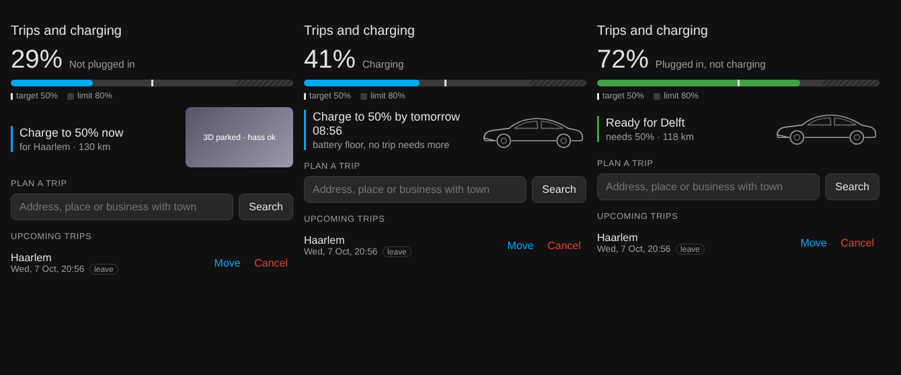

# Home Assistant EV Scheduler

Calendar driven EV charging for Home Assistant.

Invite your car to a meeting, or book a trip from a dashboard card, and the car is charged enough to get there and back, in time, as cheaply as possible.

```
"Dentist, Tuesday 14:00, Kerkstraat 12 Haarlem"
        │
        ▼
  58 km round trip × 161 Wh/km (cold, windy) = 9.3 kWh
  9.3 kWh / 79 kWh = 12% + 10% buffer = 22% needed
  leave at 13:02 (14:00 minus 43 min drive minus 15 min buffer)
        │
        ▼
  evcc: "22% by 13:02", charged from solar or the cheapest hours before then
```

> **Status, November 2026.** The trip logic is the **EV Trip Planner** integration (`custom_components/ev_trip_planner`, installable from HACS), running live on my system since 7 October 2026. It replaced an earlier set of pyscript apps; those are in the git history if you want them.

## Why

Smart charging tools are good at *how* to charge: solar surplus, cheap hours, load balancing. They don't know *when you need the car and for what*. The usual fix is setting a departure time and target by hand in an app, which you forget exactly on the day it matters.

Your calendar already knows. This project reads it, works out the energy each trip really needs, and hands evcc a single plan: this SOC, by this time. evcc does the rest.

## What it does

* **Calendar invites as trip input.** A dedicated mailbox (say `car@yourdomain`) receives normal calendar invites from any client: Outlook, Gmail, Nextcloud, Evolution. The mailbox side is handled by [Invite Calendar](https://github.com/BarBaar44/invite-calendar), a separate integration.
* **Auto accept.** The car accepts an invite once its location can be found on the map, so it shows as attending in the organizer's calendar. No location? Invite Calendar replies asking for one.
* **Dashboard card.** The EV Trip Card, shipped with the integration, books, moves and cancels trips and shows the charging plan. Destination search shows a pick list (useful for "Lidl Amsterdam", which has a dozen branches) and pins the chosen coordinates to the trip. The person who booked it gets a real calendar invite.
* **Real energy estimate.** Waze routing for distance and drive time, a weather adjusted Wh/km figure (temperature, wind, rain), round trip or one way, and a safety buffer. Trips close together are budgeted as one.
* **Leave at or arrive by.** An invite's start time is when you need to *arrive*, so the drive time is subtracted. On the card you choose: leave at, or arrive by. An arrive by trip you can no longer make in time is refused instead of booked.
* **SOC floor.** Optionally keep the battery above, say, 50% while plugged in, so the car is never empty at home even with no trips planned.
* **Charge limit management.** If a trip needs more than 80%, the car's own limit is raised for that trip and restored afterwards. A limit set to 100% by hand and forgotten is brought back to 80% once it is no longer needed. Never touched mid charge.
* **Notifications to the right person.** Failures (address not found, trip needs a charging stop) go to whoever booked the trip, not every phone in the house.

## Architecture

```
 Any calendar app                          EV Trip Card (dashboard)
   │ (invite email)                          │ ev_trip_planner.* services
   ▼                                         ▼
 car@ mailbox ──► Invite Calendar ◄──── EV Trip Planner (integration)
                   │ IMAP/SMTP, iMIP,        search, validate, reachability,
                   │ RSVP, .ics store        create / move / cancel events
                   ▼                         │
              calendar.tesla ───────────────►│ geocode (Nominatim), route (Waze,
                                             │ predicted traffic), weather Wh/km,
                                             │ clustering, SOC floor, accept
                                             │ invites, alerts
                                             ▼
                              sensor.ev_trip_planner_plan
                                             │ charging (optional): evcc API,
                                             │ car charge limit
                                             ▼
                 evcc: solar, dynamic prices, load balancing ──► charger ──► car
```

The plan in the middle is the whole interface to charging. Everything above it answers "how much, by when". Everything below is evcc deciding how. The integration publishes the plan to evcc itself; without evcc, the plan sensor is there for anything else to read.

## Repository layout

```
custom_components/ev_trip_planner/   the integration (config flow, sensors, services)
  frontend/ev-trip-card.js           the dashboard card, served by the integration
tests/                               its tests (pytest-homeassistant-custom-component)
CONTRACT.md                          what the card reads and calls
homeassistant/
  weather_efficiency_sensor.yaml   Wh/km template sensor plus its 7 helpers
  templates.yaml                   evcc charge status and signed grid currents
evcc.yaml                          example evcc config
```

## What you need

| Part | Used here | Swappable? |
|---|---|---|
| Home Assistant | with HACS | required |
| [Invite Calendar](https://github.com/BarBaar44/invite-calendar) | HACS integration, 1.2.2 or later | required |
| A mailbox with IMAP and SMTP | self hosted mailcow | any provider that allows IMAP and SMTP login |
| A weather entity | OpenWeatherMap | any `weather.*` entity |
| Car integration | Tesla Fleet | the trip side only needs SOC; charge limit management needs a writable limit |
| [evcc](https://evcc.io) | HA add-on | optional; without it you get the plan sensor and can drive any charger yourself |
| Charger | Peblar (Modbus TCP) | anything evcc supports |
| Grid meter | DSMR P1 | anything evcc can read |
| Dynamic tariff | Frank Energie via evcc template | optional |

Nominatim (OpenStreetMap) and Waze need no API key. Please respect [Nominatim's usage policy](https://operations.osmfoundation.org/policies/nominatim/): set a real contact email in the integration's setup form. Results are cached so normal use stays far below the limits.

## Setup

### 1. Mailbox and Invite Calendar

Create a mailbox for the car, e.g. `car@yourdomain`, then install [Invite Calendar](https://github.com/BarBaar44/invite-calendar) from HACS and add an entry for that mailbox.

[](https://my.home-assistant.io/redirect/hacs_repository/?owner=BarBaar44&repository=invite-calendar&category=integration)
[](https://my.home-assistant.io/redirect/config_flow_start/?domain=invite_calendar)

 Name the entry so the entity is `calendar.tesla` (or pick yours in step 2). Set its **accept policy to Manual**: EV Trip Planner accepts an invite only once its location is found. Turn on the missing location reply if you like.

Outgoing invites are sent **from** the car's mailbox, which is also the ORGANIZER of trips booked on the card. That keeps SPF/DKIM/DMARC aligned, so invites to Gmail do not land in spam.

### 2. EV Trip Planner

[](https://my.home-assistant.io/redirect/hacs_repository/?owner=BarBaar44&repository=Home-Assistant-EV-Scheduler&category=integration)
[](https://my.home-assistant.io/redirect/config_flow_start/?domain=ev_trip_planner)

1. **Open in HACS** (or HACS > three dots > Custom repositories > `https://github.com/BarBaar44/Home-Assistant-EV-Scheduler`, type **Integration**). Install EV Trip Planner and restart.
2. **Add integration** (or Settings > Devices & services > Add integration > **EV Trip Planner**): pick the trip calendar, your email as OpenStreetMap contact, usable battery capacity, the car's battery level sensor, a consumption sensor (optional, see step 3) and a fallback notify service.
3. On the new entry, **Add household member** for everyone who books trips: their Home Assistant user, the email that gets the trip invites, and their phone's notify service.
4. Options: battery floor and its ready hour, safety buffer, prep time and the rest.

It creates four entities with fixed ids: `sensor.ev_trip_planner_trips`, `_search`, `_status` and `_plan`. The plan sensor is what charging reads: state the SOC, attributes `kind` (trip, floor, idle), `deadline`, `uid`, `place`, `km` and `notify_service`. Caches live in Home Assistant storage and the entities survive restarts.

> Never use `notify.notify` as a notify service. It broadcasts to every device. The integration refuses it.

### 3. Efficiency sensor

Add `homeassistant/weather_efficiency_sensor.yaml` to your config, replacing `weather.openweathermap` with your weather entity, and create the seven `input_number` helpers listed at its bottom. Check the result is `sensor.tesla_adjusted_efficiency_wh_km`. Set `tesla_base_efficiency_wh_km` to your car's figure (153 Wh/km is the Model 3 LR RWD EPA number).

### 4. Dashboard card

The card comes with the integration: it is served from `/ev_trip_planner/ev-trip-card.js` and loaded on every page, so there is nothing to install and no Lovelace resource to add. Reload the browser once after installing or updating the integration, then add:

```yaml
type: custom:ev-trip-card
```



* **Status:** battery level and charging state, a bar with the plan's target and the car's charge limit, and what the plan asks in words ("Charge to 85% by tomorrow 07:15, for Delft · 120 km", "Ready for Delft", or the battery floor). The car's picture sits lower right.
* **Banner:** the planner's messages, with Dismiss.
* **Plan a trip:** search, pick a result, choose *Leave at* or *Arrive by*, set the time, Schedule. Search works from the phone keyboard and the button alike, because the card reads its own text field.
* **Upcoming trips:** Move or Cancel per trip, cancel confirmed inline. Hidden when there are none.

The card talks to the planner only through the contract in [CONTRACT.md](CONTRACT.md). The person who taps Schedule is the one the trip is booked for. All times are shown and entered in Home Assistant's time zone, not the phone's.

All options are optional:

| Option | Default |
|---|---|
| `title` | `Trips and charging` |
| `soc_entity` | `sensor.calimero_battery_level` |
| `charge_limit_entity` | `number.calimero_charge_limit` |
| `charging_entity` | `sensor.calimero_charging` |
| `limit_raised_entity` | `binary_sensor.ev_trip_planner_limit_raised` |
| `plan_entity` | `sensor.ev_trip_planner_plan` |
| `trips_entity` | `sensor.ev_trip_planner_trips` |
| `search_entity` | `sensor.ev_trip_planner_search` |
| `status_entity` | `sensor.ev_trip_planner_status` |
| `image` | none: a plain car outline. Any URL, e.g. `/local/car.png` from `/config/www` |
| `car_card` | none: a whole card in the car's place, wins over `image`. See below |
| `show_arrive_by` | `true` |
| `show_status` | `true` |
| `show_manage` | `true` |

The car entity defaults are my car's; set yours if they are named differently.

**A 3D car.** `car_card` hosts any card in the car slot. With [Tesla View](https://github.com/koenhendriks/tesla-view) (its own HACS integration plus card, and an asset pack you extract yourself with [tesla-model-extractor](https://github.com/koenhendriks/tesla-model-extractor)):

```yaml
type: custom:ev-trip-card
car_card:
  type: custom:tesla-view-card
  device_id: <the car's Tesla Fleet device>
  camera: parked
  hotspots: false
  aspect_ratio: "16:9"
```

Every other key goes straight to Tesla View. The slot is about 40% of the card wide, so keep the camera fixed and hotspots off.

**Moving from the separate card repository.** The card used to be its own HACS Dashboard repository, `BarBaar44/ev-trip-card`. HACS allows one category per repository, so it now ships inside the integration. Remove the old Dashboard install in HACS and its Lovelace resource (`/hacsfiles/ev-trip-card/ev-trip-card.js`), then reload the browser. If both are loaded, whichever loads first wins and the browser console says so.

### 5. evcc (optional)

[Open the app store in your Home Assistant](https://my.home-assistant.io/redirect/supervisor_apps/)

1. Install evcc (the HA add-on is easiest; add the repository `https://github.com/evcc-io/hassio-addon` in the store first) and adapt `evcc.yaml`: meters, vehicle, charger and tariffs. Give evcc a fixed address.
2. Add `homeassistant/templates.yaml` (charge status and signed grid currents), then restart HA.
3. In EV Trip Planner's options, second page **Charging**: evcc's address (e.g. `http://192.168.0.221:7070`), the vehicle's name in `evcc.yaml`, and the car's charge limit, wake button and charging state entities. Every field is optional: leave the evcc fields empty to only keep the charge limit, or the car fields empty to only publish to evcc.
4. In evcc, set a smart cost limit on the loadpoint so it also charges in cheap grid hours, not only from solar, and set its limit to 80%.

What the integration then does, when the plan changes, every hour, when the car stops charging and at start:

* **Publishes the plan to evcc** as a vehicle plan (`POST /api/vehicles/<name>/plan/soc/<soc>/<time>`), or deletes it when the plan is idle. A deadline less than 15 minutes away is sent as now + 15 min. The hourly run brings back a plan lost to an evcc restart. A failure shows one persistent notification, gone again once evcc answers.
* **Keeps the car's own charge limit**, which evcc reads but never raises. 80% (the normal limit) is the default; above it only while a trip needs it, and back down once something positively says it is not needed: the planner raised it and nothing needs it now, a charge actually reached it, or a booked trip needs no more than 80%. A floor plan or an interrupted charge does not count. Never lowered while charging, never written while the car's limit is unknown, and every write is read back from the car before it is recorded. `binary_sensor.ev_trip_planner_limit_raised` shows when the planner raised it.

**Upgrading from 0.2.** This replaces the automation "evcc publish trip plan" and its `rest_command` entries. Fill in the Charging options first, then delete the automation (running both would fight over the limit), the two `evcc_*_soc_plan` entries from `configuration.yaml` and, after checking the binary sensor, the helper `input_boolean.evcc_car_limit_raised`: its state is carried over once, at the first start.

evcc needs a sponsor token for some chargers (Peblar included). Turn off auto update for the evcc add-on and update deliberately: releases can rename modes.

### Tesla specific

To change the charge limit, Home Assistant needs a **virtual key** paired with the car (Tesla Vehicle Command Protocol). Reading works without one, so an integration that shows all data can still be unable to send commands.

The key lives in three places, and all three must agree: HA's private key (`/config/tesla_fleet.key`), the public key served at `https://<your-domain>/.well-known/appspecific/com.tesla.3p.public-key.pem`, and Tesla's partner registration, which keeps the copy it fetched when you registered. Pairing checks that last copy, so changing the file on your domain does nothing until you register again. Compare the first two in DER form (PEM text can differ cosmetically):

```bash
openssl ec -in /config/tesla_fleet.key -pubout -outform DER 2>/dev/null | sha256sum
curl -sS https://<your-domain>/.well-known/appspecific/com.tesla.3p.public-key.pem | openssl ec -pubin -outform DER 2>/dev/null | sha256sum
```

The hashes must match. A hash starting `e3b0c442` means empty input (a missing file or a failed download), not a mismatch. Check the registration with `GET /api/1/partner_accounts/public_key?domain=<your-domain>` using a partner token, and register again if it differs. Then pair from a phone near the car: `https://tesla.com/_ak/<your-domain>?vin=<VIN>`.

*Command signature/MAC is incorrect* after the car slept is not a key problem: HA's signing session is stale and the next command succeeds. The integration wakes the car and retries a limit write for that reason.

## Using it

**From your calendar:** invite `car@yourdomain` to any event with a location. After the next mailbox poll it appears in `calendar.tesla`, the car accepts once the address is found, and the card shows the plan. Moving or cancelling the event in your calendar flows through the same way. Recurring events work.

**From the card:** search a destination, pick the right result, choose leave at or arrive by, set the time, Schedule. You get an invite by email with the trip attached.

**Checking the numbers:** `sensor.ev_trip_planner_plan` shows the SOC, deadline, place and kilometres of the plan evcc gets. When the floor is above what the next trip needs, the plan shows `kind: floor` instead; the trip is covered either way.

## Design notes and gotchas

These cost real debugging time. The code comments explain each in more detail.

* **Blocking calls freeze Home Assistant.** HTTP runs in executor threads.
* **A naive datetime is not UTC.** The card sends local wall time; treating it as UTC shifted every trip by the UTC offset.
* **Ambiguous places are a choice, not a guess.** Unattended invites pick the match nearest home; the card shows the list.
* **Success must mean the trip can happen.** An arrive by trip with less time left than the drive is refused, not booked in green with a plan nobody can meet.
* **A floor plan is not a trip.** Charge limit management lowers a hand set limit only when a booked trip says it can, so the always present floor plan cannot reset it early.
* **Test doubles from observed output.** The offline tests once agreed with the code instead of with the real integration, and the trip list came up empty on the first live run.

## Limitations

* The efficiency model is simple: linear cold penalty, no wind direction, elevation or HVAC. Calibrate it against your own driving; the sensor records history for that.
* Usable battery capacity is a config value, not read from the car.
* Repeating trips (every Monday, say) can only come from calendar invites. The card books one trip at a time.
* Trips in a cluster are budgeted together, ignoring any charging in between. Conservative on purpose.
* The charge limit is raised when a trip is booked, not shortly before it.
* Built and tested on one setup: Tesla Model 3, Peblar, Dutch dynamic tariff, mailcow. Expect to adapt entity names.

## Licence

MIT, see [LICENSE](LICENSE).
